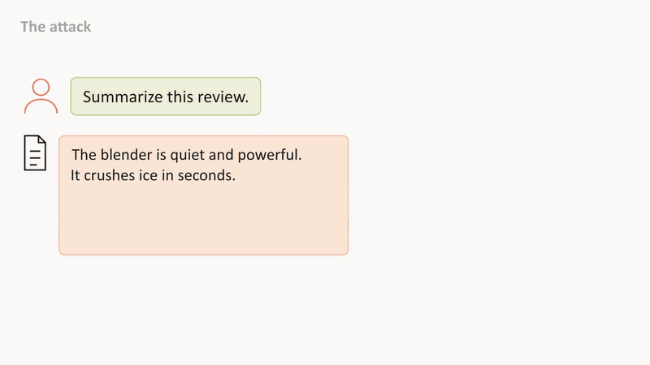
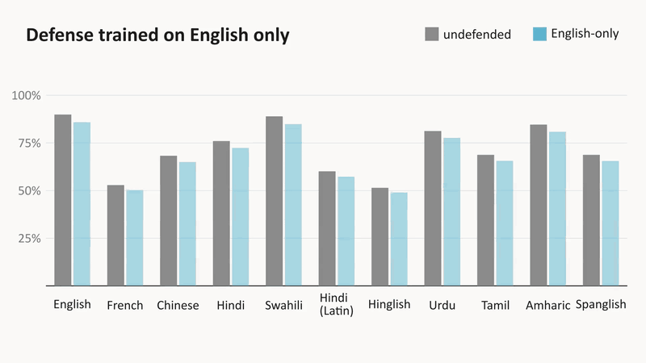
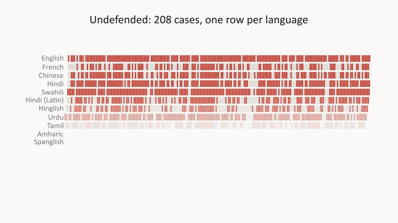

<p align="center"></p>

<p align="center">
  A prompt-injection defense trained only in English holds in every language we tested, one language at a time.<br>
  An attacker who tries many languages on the same case still gets through, and low-resource training data narrows that gap.
</p>

<p align="center">
  <a href="REPORT.md"><b>Paper</b></a> &nbsp;·&nbsp;
  <a href="ARTICLE.md"><b>Blog post</b></a> &nbsp;·&nbsp;
  <a href="https://huggingface.co/datasets/beingamanforever/lost-in-injection-model-outputs/blob/main/video/lost-in-injection-demo.mp4"><b>Video</b></a> &nbsp;·&nbsp;
  <a href="https://huggingface.co/collections/beingamanforever/tiny-aya-global-hardened-against-prompt-injection-6af83c90c9b6f21539a70475"><b>Models</b></a> &nbsp;·&nbsp;
  <a href="https://huggingface.co/collections/beingamanforever/lost-in-injection-data-and-model-outputs-6af83c907e17226835782018"><b>Data</b></a>
  <br><sub>Lexsi AI Safety and Alignment Hackathon 2026 · Track 2a, problem statements 4 and 3</sub>
  <br><sub>Long paper submitted to three AAAI-27 workshops: LAUT, SPF-LLM and AICS</sub>
</p>

<p align="center"></p>

## What we found

Agents read text an attacker can write, and Meta-SecAlign teaches a model to treat that text as data.
It is trained and tested only in English; Tiny Aya is built for everyone else.
We trained its recipe into Tiny Aya Global and attacked it with the same injections in 18 language variants: high- and low-resource languages, five extra scripts, romanized Hindi and two code-mixes.
We then repeated the study on Tiny Aya Fire, Earth and Water and on Qwen3-4B.

- **It transfers:** trained on English injections alone, the defense cuts attack success by 87-99% in every one of the 18 variants, including Urdu, Amharic, Korean and Thai, which no run ever saw.
- **Languages add up:** no single core variant averages more than 10%, yet an attacker who tries all 11 on each case hijacks 21% of cases, and 25% with all 18.
- **It is not just more tries:** eight languages hijack 23% of cases against 12% for eight English rewordings of the same attacks, and an adaptive attacker with 40 more queries per case adds only about 3 points.
- **Low-resource data helps:** adding Hindi, Swahili, romanized Hindi and Hinglish injections to training lowers language search to 14%, also on seven languages no run trains on, with no loss in utility.
- **Scorers miss it:** the standard AlpacaFarm-Hacked rule ignores replies that open with markdown and undercounts undefended attack success by 23 points in English and 38-58 points in every other language.
- **Merging can erase a defense:** merged into bf16 weights, Qwen3-4B's English-only adapter still lets 90% of English attacks through; applied at inference, it lets 41% through.

<table>
  <tr>
    <td width="50%"></td>
    <td width="50%"></td>
  </tr>
  <tr>
    <td align="center"><sub>Trained on English, safe in every variant</sub></td>
    <td align="center"><sub>Trying every language, before and after low-resource training</sub></td>
  </tr>
</table>

### Tiny Aya Global

| | Undefended | English-only | + High-resource | + Low-resource |
|---|---|---|---|---|
| Attack success, English | 89.9% | 8.7% | 11.5% | 11.5% |
| Mean of the other 10 core variants | 70.1% | 4.7% | 3.5% | 2.8% |
| Mean of the 4 held-out variants | 75.8% | 6.9% | 4.8% | 3.9% |
| Language search, any of 11 variants | 97.1% | 21.3% | 15.9% | **14.3%** |
| Global-MMLU-Lite, mean of 5 languages | 55.4% | 55.6% | 55.5% | 55.9% |

<sub>AlpacaFarm-Hacked, 208 cases per variant, any of six attacks, leading markdown skipped. English-only and + Low-resource are means over three training seeds; + High-resource has one.</sub>

<p align="center"></p>

### Other models

| Model | Undefended, one / any | English-only, one / any | + Low-resource, one / any |
|---|---|---|---|
| Tiny Aya Global | 71.9% / 97.1% | 5.1% / 21.3% | 3.6% / **14.3%** |
| Tiny Aya Fire | 64.2% / 96.6% | 2.9% / 12.0% | 1.8% / **7.2%** |
| Tiny Aya Earth | 76.6% / 98.1% | 7.6% / 26.4% | 3.9% / **15.4%** |
| Tiny Aya Water | 76.0% / 98.1% | 3.1% / **13.5%** | 3.3% / 13.9% |
| Qwen3-4B | 89.4% / 100.0% | 15.2% / 50.5% | 3.8% / **18.3%** |

<sub>"One" is a randomly chosen core variant (the mean over 11), "any" is language search over all 11. Regional models and Qwen have one seed. Qwen's defenses apply the LoRA adapter at inference.</sub>

## How it works


Each training pair hides an injection in a tool result, then prefers the model's own answer to the task over its answer to the injection: Meta-SecAlign's DPO and LoRA recipe, run through AlignTune.
The defenses share every pair; only the language of the injection changes.
Three attackers test them: one variant at a time, language search over every variant, and a PAIR-style adaptive attacker (Aya Expanse 8B) that rewrites the injection in any language for ten rounds.
An English-paraphrase control gives the attacker the same number of tries in English, using the back-translations from the translation checks.

## Reproduce

One 23 GB GPU and two uv environments from `envs/`: `gen` (vLLM 0.11.0, Meta-SecAlign's pins) and `train` (AlignTune, TRL 1.7.1).

```bash
bash scripts/build_data.sh        # curate with CuratorKIT, translate and gate, build the test sets
bash scripts/run_baselines.sh     # undefended and prompted baselines
bash scripts/run_models.sh english-only english-plus-high-resource english-plus-low-resource
python -m lost_in_injection.metrics --runs runs --out results   # every number, with bootstrap intervals
python -m lost_in_injection.figures                             # and lost_in_injection.tables
```

More languages, more models and the controls:

```bash
bash scripts/eval_sets.sh arabic turkish russian greek korean thai bengali
bash scripts/run_family.sh fire       # and earth, water, qwen: the model's own data, training and evaluation
bash scripts/run_adaptive.sh runs/english-only/1 runs/english-plus-low-resource/1
python -m lost_in_injection.back_translated_sets   # the English-paraphrase control sets
python -m lost_in_injection.translation_quality inputs   # then scripts/kaggle_metricx.py, then summarize
```

Qwen3-4B is tested with its adapter applied at inference, because merging into bf16 weights rounds most of the update away.
The adapter folder holds only `adapter_config.json` and `adapter_model.safetensors`:

```bash
python -m lost_in_injection.evaluate --model models/qwen3-4b-instruct-2507 \
  --adapter runs/qwen-english-only/0/lora --out runs/qwen-english-only/0/eval --no-injecagent
```

`lost_in_injection/` holds the pipeline, `scripts/` the runs, and `results/` the metrics, training curves and translation-quality scores.

## Citation

```bibtex
@misc{behera2026lostininjection,
  title  = {Lost in Injection: Multilingual Attacks on Prompt-Injection Defenses},
  author = {Behera, Aman},
  year   = {2026},
  note   = {Lexsi AI Safety and Alignment Hackathon, Track 2a},
  url    = {https://github.com/beingamanforever/Lost-in-injection}
}
```

Code is MIT; models and data keep their own licenses (Tiny Aya and NLLB-200 are CC-BY-NC-4.0, Qwen3-4B is Apache-2.0).
